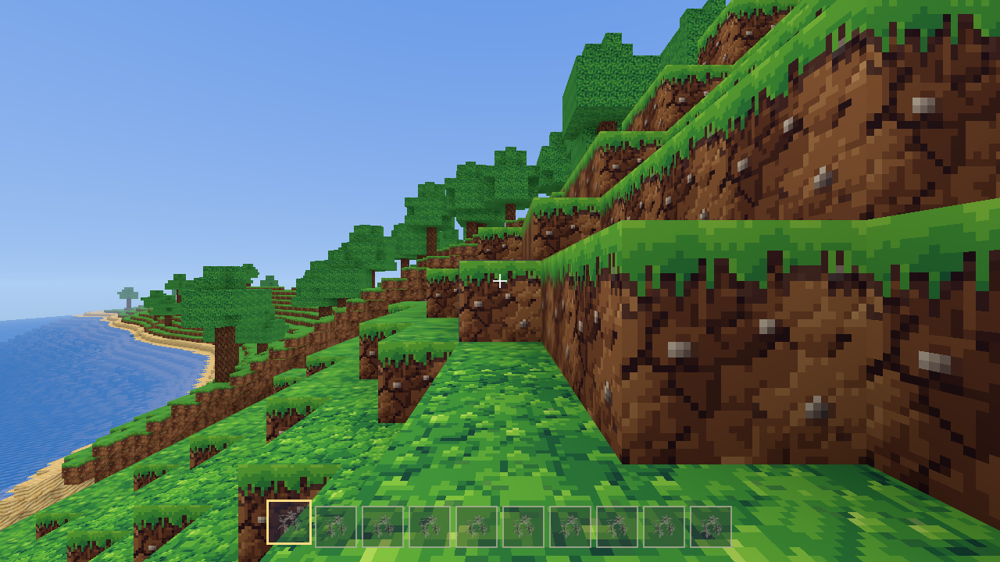

# Boundmore

A persistent online voxel universe in the spirit of *Boundless*: a world of planets that wrap around, built, shared and traded on by everyone in it. All art, names and code are Boundmore's own.



**Status:** milestone 3 (accounts, inventory, tools, crafting, workbench and furnace, land claims) is built and awaiting a play-test. Milestones 1 and 2 (foundation; light, day and night, textures) are done. See `docs/roadmap.md` for what comes next.

## Running it

You need [Rust](https://rustup.rs) (1.85 or newer).

```
cargo run --release -p bm-server
```

In a second terminal, from the same folder:

```
cargo run --release -p bm-client
```

The game opens on a login screen: pick a name and password and press **Create account** the first time, **Log in** after. The name and server are remembered (never the password).

Controls:
- Click to capture the mouse; Esc releases it or closes a menu.
- WASD to move, Space to jump (and to swim up; push against a shore with Space held to climb out), Shift to sprint.
- **Hold** the left button to break a block; it goes into your inventory. Right click places the selected block. 1 to 0 or the mouse wheel pick a hotbar slot.
- **I** (or Tab) opens the inventory: drag to move, right drag or Shift drag to split, drop on Throw away to discard.
- **C** opens crafting: things you make by hand, or, looking at a workbench or furnace, what it makes. Stations keep working while you are away; collect from them later.
- **P** toggles claim mode: left click a plot beside your claim to add it, right click to give it up. Place a claim stone to start a claim. A claim stays yours as long as you visit at least once every 6 months.
- F11 for fullscreen.

Getting started: break tree trunks by hand, craft timber, then a workbench; break stone for a furnace and stone tools; coal and copper from the rocks make copper tools.

To play across machines, open UDP port 7777 on the server and give each player the server's `data/server.cert.der`:

```
cargo run --release -p bm-client -- --server 203.0.113.5:7777 --cert server.cert.der
```

Load testing: `cargo run --release -p bm-server --example bots -- --count 50`.

## Updating

```
git pull
cargo run --release -p bm-server
cargo run --release -p bm-client
```

Stop the running server (Ctrl+C in its window) and close the game before rebuilding: Windows will not let a running program be replaced, and the build fails with `failed to remove file ... bm-server.exe: Access is denied`. If a copy is still running somewhere, `taskkill /IM bm-server.exe /F` and `taskkill /IM boundmore.exe /F` stop them.

## Layout

| Crate | What |
|---|---|
| `bm-core` | blocks, chunks, coordinates, planets, movement shared by server and client |
| `bm-worldgen` | planet generation (server only) |
| `bm-mesh` | chunk meshing |
| `bm-protocol`, `bm-net` | the wire protocol and QUIC transport |
| `bm-server` | the authoritative server |
| `bm-client` | the game (`boundmore`) |

Design decisions are in `docs/decisions/`; the rules every change follows are in `CLAUDE.md`.
