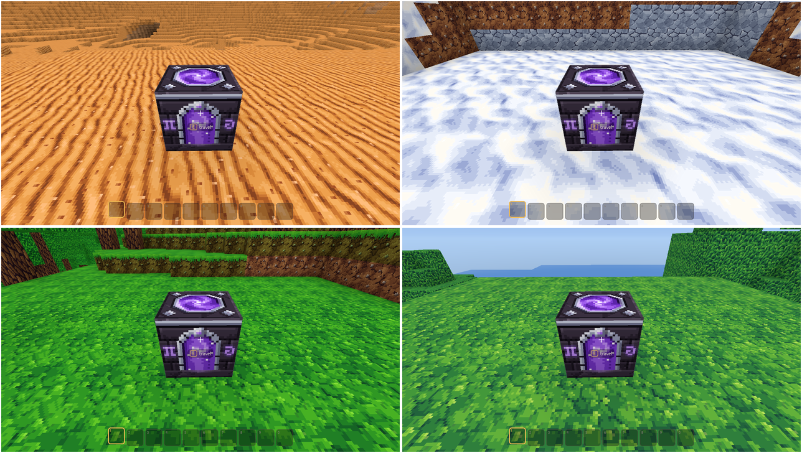

# Boundmore

A persistent online voxel universe in the spirit of *Boundless*: a world of planets that wrap around, built, shared and traded on by everyone in it. All art, names and code are Boundmore's own.



**Status:** milestones 4 to 6 (a universe of four planets, warp shrines, iron; storage chests and chat; block colours, planet colours, claims lapsing to coloured ash) are built and awaiting a play-test. Milestones 1 to 3 (foundation; light and textures; accounts, inventory, crafting and claims) are built. See `docs/roadmap.md` for what comes next.

## Running it

You need [Rust](https://rustup.rs) (1.85 or newer).

```
cargo run --release -p bm-server
```

In a second terminal, from the same folder:

```
cargo run --release -p bm-client
```

The game opens on a login screen: pick a name and password and press **Create account** the first time, **Log in** after. The name and server are remembered (never the password).

Controls:
- Click to capture the mouse; Esc releases it or closes a menu.
- WASD to move, Space to jump (and to swim up; push against a shore with Space held to climb out), Shift to sprint.
- **Hold** the left button to break a block; it goes into your inventory. Right click places the selected block. 1 to 0 or the mouse wheel pick a hotbar slot.
- **I** (or Tab) opens the inventory: drag to move, right drag or Shift drag to split, drop on Throw away to discard.
- **C** opens crafting: things you make by hand, or, looking at a workbench or furnace, what it makes. Stations keep working while you are away; collect from them later.
- **P** toggles claim mode: left click a plot beside your claim to add it, right click to give it up. Place a claim stone to start a claim. A claim stays yours as long as you visit at least once every 6 months.
- **E** at a warp shrine (the glowing violet block at each planet's spawn) opens the travel menu: pick a planet to go there.
- **E** on a storage chest (workbench, 8 timber) opens it beside your inventory: drag between them, or Shift-click to send a whole stack across.
- Blocks have colours: what you break keeps its colour in your pack (stacks of different colours stay apart) and is placed in it. New planets colour their ground, rock and trees from a palette of 255 colours, in large patches worth exploring for.
- A claim whose owner has not visited for 6 months crumbles to ash in the colours of what was built; anything stored in it waits in the owner's **Reclaim** tab at any warp shrine.
- **Chisels** (workbench: square from stone, slope from copper, bevel, round and the precise ones from iron): left click cuts the part of the block you aim at (outlined in yellow), right click fills it back (blue). Natural ground takes slope chisels only. You can walk up half-block cuts without jumping.
- **Enter** or **T** opens chat. `/l`, `/p` and `/u` switch between local (nearby), planet and universe; `/w name text` whispers and `/r text` replies. Enter sends, Esc closes.
- F11 for fullscreen.

Getting started: break tree trunks by hand, craft timber, then a workbench; break stone for a furnace and stone tools; coal and copper from the rocks make copper tools. Iron is only found on the tier 2 and 3 planets (Emberdune, Rimehold, Wildmere), deeper than copper; iron tools are the fastest yet.

The server hosts four planets by default: Verdance (temperate, tier 1, where everyone starts), Emberdune (arid), Rimehold (frozen) and Wildmere (lush). `server.example.toml` shows how to change the list. An older save (`data/verdance.redb`) is upgraded into `data/universe.redb` on first start, keeping everything; the old file is left as a backup. If you log in far from the warp shrine, a notice tells you which way it is.

To play across machines, open UDP port 7777 on the server and give each player the server's `data/server.cert.der`:

```
cargo run --release -p bm-client -- --server 203.0.113.5:7777 --cert server.cert.der
```

Load testing: `cargo run --release -p bm-server --example bots -- --count 50 --planets 2` (bots spread over the first two planets).

## Updating

```
git pull
cargo run --release -p bm-server
cargo run --release -p bm-client
```

Stop the running server (Ctrl+C in its window) and close the game before rebuilding: Windows will not let a running program be replaced, and the build fails with `failed to remove file ... bm-server.exe: Access is denied`. If a copy is still running somewhere, `taskkill /IM bm-server.exe /F` and `taskkill /IM boundmore.exe /F` stop them.

## Layout

| Crate | What |
|---|---|
| `bm-core` | blocks, chunks, coordinates, planets, movement shared by server and client |
| `bm-worldgen` | planet generation (server only) |
| `bm-mesh` | chunk meshing |
| `bm-protocol`, `bm-net` | the wire protocol and QUIC transport |
| `bm-server` | the authoritative server |
| `bm-client` | the game (`boundmore`) |

Design decisions are in `docs/decisions/`; the rules every change follows are in `CLAUDE.md`.
