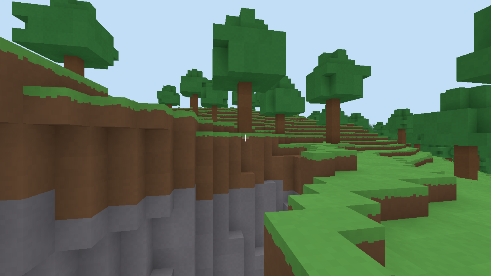

# Boundmore

A persistent online voxel universe in the spirit of *Boundless*: a world of planets that wrap around, built, shared and traded on by everyone in it. All art, names and code are Boundmore's own.



**Status:** milestone 1 (foundation) is done. You can run a server, connect, walk, jump, swim, dig and build, see other players and have everything saved. See `docs/milestones/01-foundation.md` for what exists, and `docs/roadmap.md` for what comes next.

## Running it

You need [Rust](https://rustup.rs) (1.85 or newer).

```
cargo run --release -p bm-server
```

In a second terminal, from the same folder:

```
cargo run --release -p bm-client -- --name YourName
```

Controls: click to capture the mouse (Esc releases it), WASD to move, Space to jump, Shift to sprint, left click to break, right click to place, 1 to 9 or the mouse wheel to pick a block, F11 for fullscreen.

To play across machines, open UDP port 7777 on the server and give each player the server's `data/server.cert.der`:

```
cargo run --release -p bm-client -- --name YourName --server 203.0.113.5:7777 --cert server.cert.der
```

Load testing: `cargo run --release -p bm-server --example bots -- --count 50`.

## Layout

| Crate | What |
|---|---|
| `bm-core` | blocks, chunks, coordinates, planets, movement shared by server and client |
| `bm-worldgen` | planet generation (server only) |
| `bm-mesh` | chunk meshing |
| `bm-protocol`, `bm-net` | the wire protocol and QUIC transport |
| `bm-server` | the authoritative server |
| `bm-client` | the game (`boundmore`) |

Design decisions are in `docs/decisions/`; the rules every change follows are in `CLAUDE.md`.
